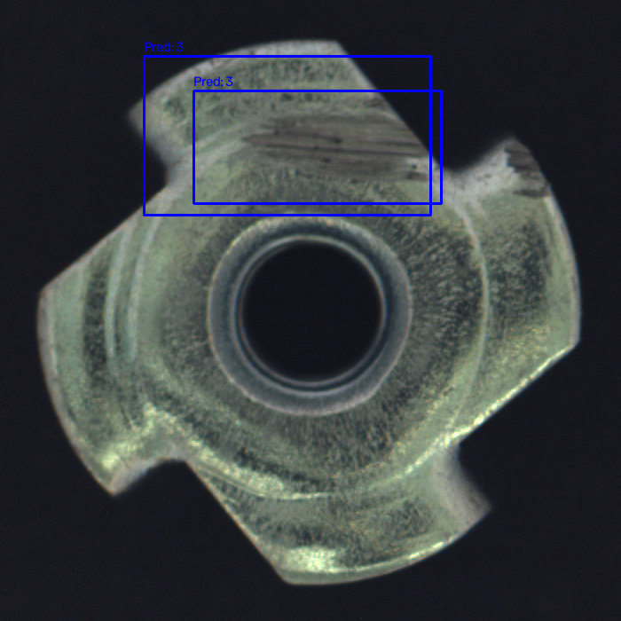
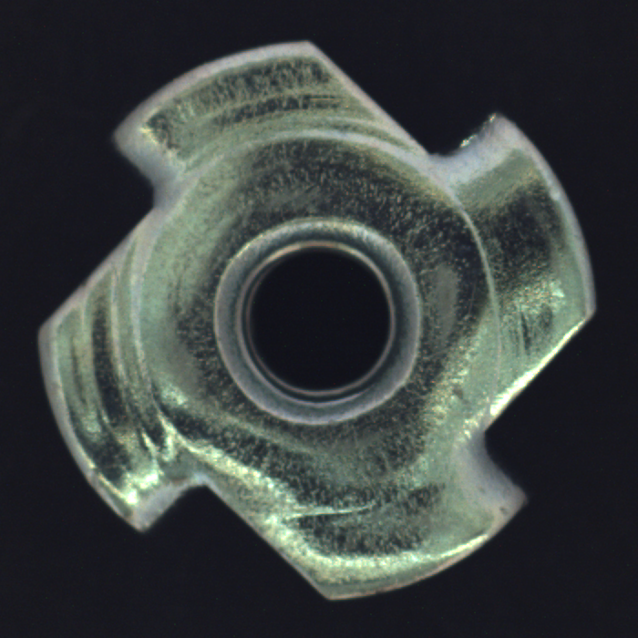
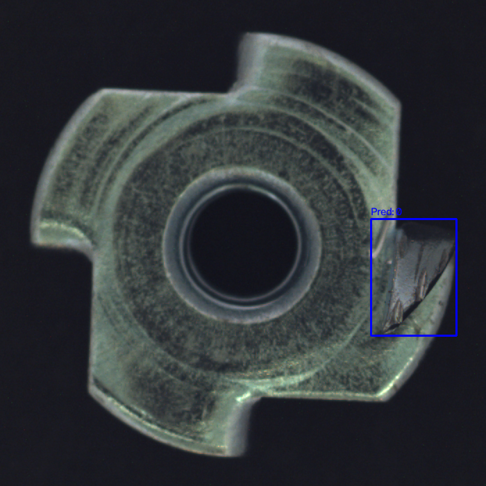
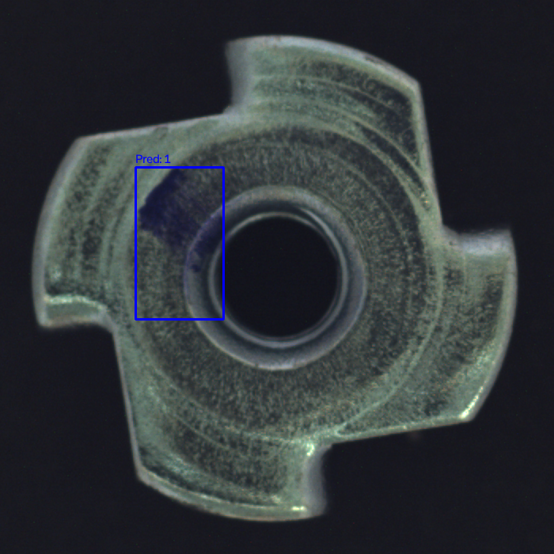
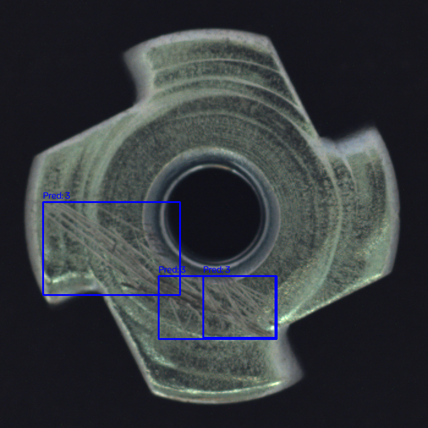

# MVTec `metal_nut` Defect Detection (Edge AI)

## 📌 Project Overview
This repository contains a complete, end-to-end computer vision pipeline for detecting and localizing defects on the MVTec `metal_nut` dataset. The goal was to train an object detector small enough for an edge device, export it to ONNX, and benchmark CPU inference speed. 

**Model Architecture:** YOLOv8n (Nano)  
**Hardware Used for Training:** Lenovo IdeaPad (NVIDIA RTX 3050 4GB, AMD Ryzen CPU)  
**Stack:** Python 3.10, PyTorch 2.5.1, Ultralytics, OpenCV, ONNX Runtime.

---

## 📊 Results at a Glance
*   **mAP@0.5:** 0.725
*   **Precision:** 0.797
*   **Recall:** 0.770
*   **ONNX Model Size:** 12.2 MB
*   **CPU Inference Speed:** 29.70 ms (Mean) / 36.12 ms (P95)

---

## 🛠️ Methodology (Assessment Steps)

### 1. Labels (Mask to Bounding Box)
The MVTec dataset provides pixel-level masks. To train YOLO, these were converted into bounding boxes using OpenCV's `connectedComponentsWithStats`.
*   **Method:** Each independent blob of white defect pixels was tightly enclosed in a bounding box and converted to YOLO's normalized format (`x_center, y_center, width, height`).
*   **Choice:** Deriving boxes from masks is deterministic, reproducible, and eliminates human error in box tightness.
*   **Data Split:** Defective images were split 60/20/20 for train/val/test. Good images were added as negative samples (empty labels) to teach the model what "normal" looks like.

### 2. Training
The model was trained using transfer learning from COCO-pretrained weights (`yolov8n.pt`). To fit within the 4GB VRAM constraint, Automatic Mixed Precision (AMP) and RAM caching were used. 

### 3. Evaluation & Failure Cases
**Overall Test Metrics:** Precision: 0.797 | Recall: 0.770 | mAP@0.5: 0.725

**Per-Class Analysis:** 
The model performed exceptionally well on `flip` (mAP 0.995) and `bent` (mAP 0.853) but struggled with `scratch` (mAP 0.256). At 640px resolution, tiny scratches blur into the brushed metal texture.

**5 Failure Cases:**
*(Note to assessor: The original images with Ground Truth (Red) and Predictions (Blue) are in the `failure_cases/` folder)*

1.  **False Negative (Scratch):** The model missed a thin scratch entirely because it occupied less than 1% of the image area and blended into the metal reflection.
    
2.  **False Positive (Good Part):** The model drew a box on a clean part because a specular lighting reflection mimicked the appearance of a stain.
    
3.  **Localization Error (Bent):** The model detected the bend but the predicted box was too loose, resulting in an IoU < 0.5.
    
4.  **Low-Contrast Miss (Color):** A low-contrast stain was missed due to the specific shadowing in that test image.
    
5.  **Double Detection (Scratch):** A single long scratch was split into two predicted boxes, reducing recall at the standard IoU threshold.
    

### 4. Export and Speed
The final model was exported to ONNX (opset 18, simplified).
*   **ONNX Size:** 12.2 MB
*   **CPU:** AMD Ryzen (Family 25 Model 68)
*   **Input Size:** 640x640
*   **Mean Latency:** 29.70 ms
*   **P95 Latency:** 36.12 ms
*   **Analysis:** The model runs at ~33 FPS on a pure CPU, proving it is highly suitable for edge deployment without requiring a dedicated GPU.

### 5. Improvement Experiment
I tested three strategies to improve the baseline mAP of 0.716:
1.  *Higher Resolution (800px) with Copy-Paste Augmentation:* Failed (mAP 0.500). Synthetic copy-paste created unrealistic artifacts.
2.  *Extended Training (150 epochs):* Failed (mAP 0.592). The model overfit the small dataset.
3.  *Cosine Learning Rate + Increased Box Loss Penalty (`box=10.0`):* **Succeeded (mAP 0.725).** By increasing the mathematical penalty for box misalignment, the model paid closer attention to tiny defects. Scratch mAP improved from 0.188 to 0.256. Crucially, this maintained the strict YOLOv8n architecture and 640px resolution required for edge deployment.

---

## 💻 Development Process & AI Usage

To accelerate development and ensure best practices, I utilized **DeepSeek (an AI coding assistant)** as an interactive pair-programmer and mentor throughout this project. The AI was instrumental in the following areas:

1.  **Environment Setup & Troubleshooting:** Assisted in resolving a corrupted 4.9GB dataset extraction using Python's `tarfile` stream mode, and helped configure a clean Python `venv` with the correct CUDA 12.1 binaries for the RTX 3050 GPU.
2.  **Hardware Optimization:** Guided the monitoring of GPU VRAM and CPU bottlenecks, leading to the use of `cache='ram'`, `amp=True`, and `rect=True` to maximize training efficiency within the 4GB VRAM limit.
3.  **Experiment Design & Analysis:** Helped diagnose why advanced augmentations (Mixup, Copy-Paste) and higher resolutions failed on the small dataset, leading to the final successful configuration (Cosine LR + Box Penalty).
4.  **Deployment Pipeline:** Provided the boilerplate for OpenCV mask conversion, ONNX export, and the `onnxruntime` CPU latency benchmarking script.

All code was reviewed, executed, and validated locally. The AI served as a guide to help me understand the *why* behind the machine learning concepts, ensuring the final solution is fully understood and reproducible.

---

## 🚀 How to Run (Step-by-Step Guide)

This guide will walk you through setting up the environment and running the project on a Windows machine (developed and tested on Windows 11).

### Prerequisites
*   **Python 3.10** installed.
*   **Git** installed.
*   *(Optional but recommended)* An NVIDIA GPU with CUDA 12.1 for faster training.

### Step 1: Download the Repository
Open PowerShell and clone the repository to your local machine:
```powershell
git clone https://github.com/YOUR_USERNAME/YOUR_REPO_NAME.git
cd YOUR_REPO_NAME
```

### Step 2: Set up the Virtual Environment
Create and activate a clean Python virtual environment:
```powershell
python -m venv .venv
.\.venv\Scripts\Activate.ps1
```

### Step 3: Install Dependencies
Install all required libraries (PyTorch, Ultralytics, ONNX, etc.):
```powershell
pip install -r requirements.txt
```

### Step 4: Download the Dataset (Required for BOTH Options)
The dataset is not included in this repository. 
1. Download the **`metal_nut`** category from the [MVTec AD dataset](https://www.mvtec.com/company/research/datasets/mvtec-ad).
2. Extract the folder and place it exactly at `C:\games\metal_nut`. 
*(If you place it elsewhere, you must update the `DATA_ROOT` variable inside `build_yolo_dataset.py` to match your path).*

---

### Option A: Evaluate the Pre-trained Model (Fastest)
The final champion weights (`improved_v3_best.pt`) are already saved in this repository. Use this option to immediately verify my results without retraining.

**1. Evaluate Metrics (Precision, Recall, mAP@0.5)**
```powershell
python evaluate.py
```

**2. Export to ONNX & Benchmark CPU Speed**
This will export the model to ONNX and measure its inference latency on your CPU.
```powershell
python export_onnx.py
```

**3. Generate Failure Case Images**
This will save images with ground-truth and predicted boxes into the `failure_cases/` folder.
```powershell
python generate_failures.py
```

---

### Option B: Train the Model From Scratch (Full Pipeline)
If you want to rebuild the dataset splits, train the YOLOv8n model, and reproduce the entire pipeline, run these steps in order:

**1. Build the YOLO Dataset**
Converts the MVTec pixel masks into YOLO bounding boxes and splits the data into train/val/test.
```powershell
python build_yolo_dataset.py
```

**2. Train the Champion Model**
Trains the V3 model using the successful Cosine LR and Box Penalty configurations.
```powershell
python train_improved_v3.py
```

**3. Evaluate the Newly Trained Model**
*Note: You must open `evaluate.py` and update the `model_path` to point to your newly trained `.pt` file inside the `runs/` folder.*
```powershell
python evaluate.py
```